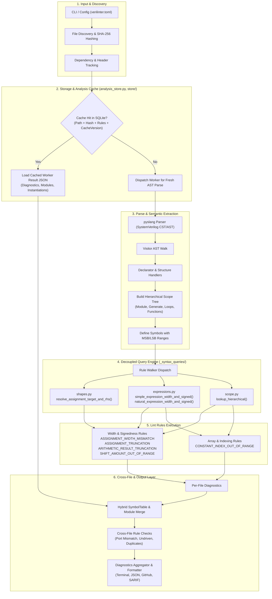
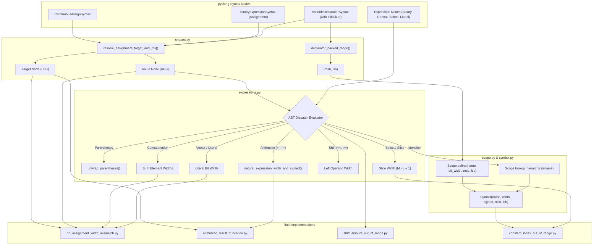
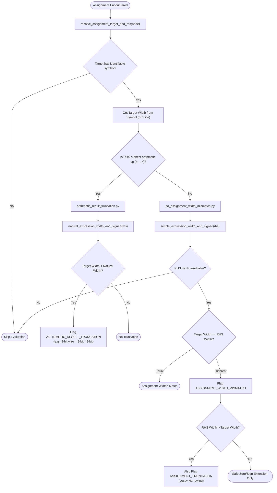
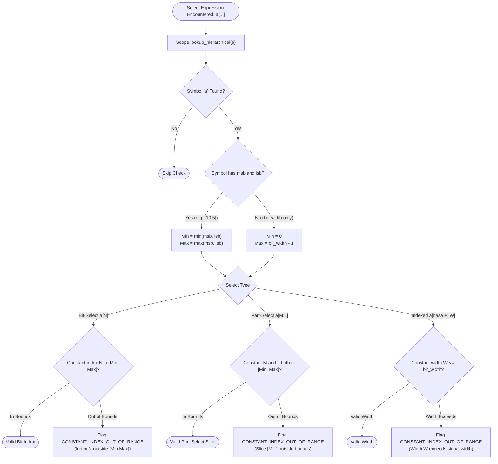
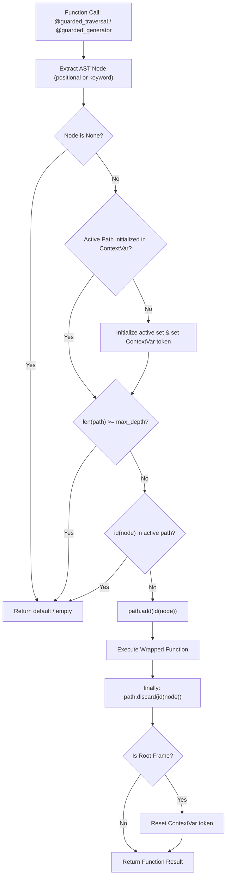

# Verilinter Architecture & Expression/Assignment Analysis

This document details the system architecture of Verilinter, the decoupled AST query engine, and the dedicated architectural subsystems for evaluating expressions and assignments in Verilog and SystemVerilog.

---

## 1. High-Level System Pipeline



---

## 2. Decoupled Expression & Shape Resolution Architecture



---

## 3. Assignment Width & Truncation Evaluation Flow



---

## 4. Constant Index Out of Range Verification Flow



---

## 5. Why Assignments and Expressions Require Dedicated Subsystem Architecture

In Verilog and SystemVerilog (IEEE 1800-2017), expressions and assignments are not simple localized syntactic tokens; they obey complex semantic typing and context-dependent width rules. Treating them as ad-hoc logic inside individual rule classes creates subtle defects and maintenance bottlenecks:

### A. Context-Determined vs. Self-Determined Widths
- For shifts (`<<`, `>>`, `<<<`, `>>>`), the shift amount is self-determined; the result width follows the left operand after applicable context sizing. The query reports the independently recoverable left-operand width, not a fully elaborated assignment-context type.
- Conversely, binary arithmetic operations (`+`, `-`, `*`) are **context-determined**: when assigned to an LHS target or used in larger expressions, their bit width expands to match the largest operand or the target width.
- When an individual rule attempts to evaluate an expression width on its own, it easily conflates self-determined width with natural/contextual width, causing either false positives (e.g. flagging a valid sign-extension) or false negatives (e.g. missing product overflow).
- **Architecture Solution**: A single query layer (`expressions.py`) explicitly distinguishes `simple_expression_width_and_signed` (which only resolves self-determined, invariant widths) from `natural_expression_width_and_signed` (which models operation-specific bit-growth).

### B. Multiple Value-Transfer Shapes (LHS & RHS)
Value transfer occurs across three fundamentally different syntax nodes:
1. Continuous assignments: `ContinuousAssignSyntax` (`assign a = b;`)
2. Procedural assignments: `BinaryExpressionSyntax` (`a <= b;`, `a = b;`)
3. Variable declarator initializers: `VariableDeclaratorSyntax` (`wire [7:0] p = a * b;`)

Furthermore, the target (LHS) can take multiple structural shapes:
- Simple identifier: `a = ...`
- Bit-select / part-select: `a[3:0] = ...`
- Indexed part-select: `a[idx +: 4] = ...`
- Concatenation / destructuring assignment: `{a, b} = ...`
- Struct / interface member select: `bundle.valid = ...`

When each lint rule parses these syntax patterns independently, coverage gaps inevitably occur (e.g. a width rule that checks continuous and procedural assignments but misses declarator initializers).
- **Architecture Solution**: `shapes.resolve_assignment_target_and_rhs` standardizes the extraction of target and RHS across all syntactic constructs, providing a single point of enforcement.

### C. Non-Zero and Descending Vector Bounds
RTL designs frequently declare buses with non-zero or ascending ranges:
```systemverilog
wire [10:5] x;
wire [0:7]  y;
```
If the semantic model only records scalar `bit_width = 6`, rules checking constant indexing (`x[6]`) will incorrectly flag valid indices as out-of-bounds (assuming `[5:0]`).
- **Architecture Solution**: `Symbol` carries explicit `msb` and `lsb` alongside `bit_width`, populated during AST declarator walking and serialized through the SQLite store.

### D. Lexical Scope vs. Upward Resolution
Complex RTL constructs (such as `generate for` loops, unrolled procedural loops, and automatic functions) nest scopes. When rules evaluate expressions inside a child scope, looking only at the immediate scope fails to find module-level nets.
- **Architecture Solution**: `Scope.lookup_hierarchical` traverses the parent pointer chain, resolving outer declarations while preserving inner shadowing.

---

## 6. Expression Typing, Arithmetic Capacity & Associative Spine Architecture

### A. Expression Query Taxonomy

The expression query layer separates three questions:

1. `simple_expression_width_and_signed` resolves value-transfer widths for
   identifiers, literals, selects, concatenations, shifts, ternaries, and
   width-preserving `$signed`/`$unsigned` casts. Direct arithmetic stays out
   of this query to preserve assignment-rule diagnostic ownership.
2. `expression_width_and_signed` resolves arithmetic operand width before
   assignment context: `+`, `-`, and `*` use the maximum operand width.
   This is also used at cast boundaries and for ternary branches.
3. `natural_expression_width_and_signed` estimates arithmetic capacity
   recursively: add/subtract use the maximum operand capacity and multiply
   sums operand capacities. Full-product capacity is a truncation policy,
   not the IEEE expression type. Addition carry-out is not estimated.

Unknown widths or signedness remain unknown. Assignment context must not be
used to fabricate an independently known operand width. Signedness casts
form self-determined boundaries; capacity is not propagated through them.
Compound assignments are excluded from plain value-transfer resolution. Explicit signedness casts, including the shifted operand, preserve intentional widening and signedness choices; narrowing remains diagnosable.
All recursive queries use traversal guards and structural syntax kinds.

Parameter folding and concatenated targets are supported. General type casts,
subroutine return types, and wider operator coverage are not; they require
explicit context and type semantics, not token parsing.

### B. Architectural Decision: In-Place Iterative Unrolling vs. Dedicated Spine Subsystem

A primary design consideration is whether associative RTL structures (cascaded ternary multiplexers, multi-operand arithmetic spines, and wide bitwise/parity reduction trees) warrant an independent intermediate representation (IR) subsystem (such as an $N$-ary expression graph, flattened spine DAG, or lowered three-address intermediate format).

Verilinter adopts **in-place iterative unrolling directly within the syntax query layer** as its core architectural pattern. This design choice is governed by four principles:

1. **Zero Allocation and Traversal Overhead**:
   In-place unrolling traverses native `pyslang.syntax.SyntaxNode` pointers using bounded iterative loops (`while` with strict iteration guards). Introducing a separate spine subsystem or intermediate lowering pass would require allocating intermediate AST wrapper nodes and managing secondary translation lifetimes across thousands of source files, adding runtime memory and garbage-collection overhead without diagnostic benefit.

2. **Preservation of Concrete Syntax Locality**:
   Lint rules and diagnostic reporters depend on exact CST node references, byte offsets, trivia tokens, and source manager locations to emit actionable diagnostics with precise line/column highlights and proposed auto-fixes. Transforming expressions into a detached intermediate spine representation strips away CST context, requiring complex back-mapping tables to trace an unrolled tap at index 48 back to its exact token span in source text.

3. **IEEE 1800 Semantic Conformance**:
   SystemVerilog specifies strict associativity rules (right-associativity for ternary `? :` and left-associativity for binary arithmetic and bitwise operators). In-place iterative unrolling evaluates nodes strictly in language-defined associativity order, preventing subtle semantic distortions, sign-extension discrepancies, or operand reordering bugs that can occur in generalized $N$-ary AST rewriters.

4. **Complexity Elimination ($O(1)$ Recursion Depth)**:
   By unrolling associative branches iteratively, call-stack recursion depth is reduced from $O(N)$ to $O(1)$. A 64-stage ternary multiplexer or 64-tap adder chain evaluates in a single stack frame with zero recursion risk, completely eliminating call-stack exhaustion and depth-bound truncation without architectural bloat.

#### Criteria for a Future Dedicated Expression Subsystem
A standalone Expression IR / Spine Subsystem would only be justified if Verilinter's scope expands into:
- **Symbolic Equivalence & Global Normalization**: e.g., re-associating non-adjacent constants across sub-expressions (`(a + 2) + 3` $\to$ `a + 5`), applying algebraic distributive laws, or canonical commutativity sorting.
- **Whole-Program SSA / Dataflow Modeling**: Inter-procedural value numbering, common subexpression elimination (CSE), or boolean satisfiability (SAT/SMT) bit-vector modeling.

For static linting, structural width checking, constant folding, and rule verification, in-place iterative unrolling is the strictly optimal, lowest-overhead, and highest-fidelity design.

---

## 7. Dependency Injection & Modular Subcomponent Architecture

Verilinter employs dependency injection (DI) across its analysis pipeline, walker, and AST handlers to enable isolated testing, mock backends, and decoupled extension:

### A. Pipeline & Storage Dependency Injection (`engine.py`)
`LintPipeline` accepts optional dependency injection in its constructor:
- `rule_runner`: Custom or filtered `RuleRunner` instance for syntax AST rules.
- `symbol_rule_runner`: Custom `SymbolRuleRunner` instance for per-file symbol table rules.
- `module_rule_runner`: Custom `ModuleRuleRunner` instance for cross-file module rules.
- `store`: Custom `AnalysisStore` or mock storage backend, decoupling analysis runs from physical SQLite database creation during unit tests.

Injected runners are executed identically across in-memory syntax trees (`analyze_trees`) and on-disk files (`analyze_paths`).

### B. AST Walker Decoupling (`walker.py`)
`Walker` accepts injectable:
- `dispatch`: Custom `Dispatch` registry for routing AST nodes to handlers without modifying the global dispatch table.
- `vnode_factory`: Custom node factory/wrapper, allowing mock vnode generation in unit tests without module monkeypatching.

### C. Handler Subcomponent Decomposition (`handlers/`)
Complex AST handlers decompose disparate concerns into injectable strategy subcomponents:
- **`IdentifierNameHandler`**:
  - `StructuralReferenceFilter`: Configurable predicates to filter non-referential identifier tokens.
  - `SymbolResolver`: Looks a name up across lexical/package scopes, with injectable `qualifier_fn`, and returns a `Resolution` (resolved, unresolved as an implicit net, unresolved as undeclared, or unresolvable from this file). It does not change the symbol table.
  - `UnresolvedNameRecorder`: For a name with no declaration, creates the placeholder symbol that collects its uses in the enclosing module, package or subroutine scope and records an `UnresolvedReference` on `SymbolTable.unresolved_references`. `NO_IMPLICIT_NET` and `UNDECLARED_VARIABLE` read those references.
  - `UseEventContextExtractor`: Extracts access modes, driver blocks, and branch exclusivity signatures.
  - Interface members: a member selected through an interface port or instance (`b.req`) is recorded against the member's symbol in the interface declaration. Uses are queued on the `SymbolTable` and applied when the walk of the file ends, so an interface declared after its first use resolves. Only a plain `base.member` form on a port or instance declared in the same file is followed; array-of-interface indexing and interfaces declared in other files are not.
- **`HierarchyInstantiationHandler`**:
  - `ParameterOverrideExtractor`: Extracts parameter overrides and computes style, accepting an injectable constant `evaluator`.
### D. Typed Context Frames & Ancestor Traversal (`walk/context.py`)
`Context` encapsulates immutable traversal state and provides typed context frames to eliminate untyped string-keyed dictionary communication between handlers and rules:
- **`ModuleFrame`**: Captures enclosing module raw AST, asynchronous reset signals, and module-level AST query caches (`cache: dict[object, object]`).
- **`ProceduralBlockFrame`**: Captures enclosing procedural block AST, precomputed sensitivity violations (`missing_sensitivity`), mixed-assignment triggers (`mix_trigger`), non-blocking write triggers, combinational classification (`is_comb`), and block-level asynchronous reset names (`async_reset_names`).
- **`CaseStatementFrame`**: Captures enclosing case statement AST and precomputed FSM transition models (`fsm_model`).
- **`iter_ancestors(include_self=True)`**: Traverses parent pointers directly from innermost to outermost, eliminating $O(D)$ list allocations and reversals while enforcing cycle immunity and `< 256` depth bounds.

---

## 8. AST Traversal Guard & Active-Path Cycle Immunity Subsystem

To guarantee complete loop immunity, bound recursion depths, and eliminate manual boilerplate across AST query functions, Verilinter introduces the `TraversalGuard` subsystem (`traversal_guard.py`).

### A. The Challenge: PyBind11 Wrapper Address Recycling vs. Cycle Detection

When analyzing syntax trees with `pyslang`, the Python wrapper `pyslang.SyntaxNode` and token objects are created dynamically on the fly across PyBind11 C++/Python boundaries.

```
       [Parent Node]
       /           \
[Child 1: PyObject 0x1000]   [Child 2: PyObject 0x1000]
(enters, exits, garbage collected) -> (allocated at recycled address 0x1000!)
```

1. **Address Recycling Hazard**:
   - If a traversal keeps a flat set of visited integer IDs (`visited: set[int] = set()`) and leaves IDs in the set across sibling iterations, a critical failure occurs.
   - Child 1 is processed; when it goes out of scope, Python frees its memory address (e.g. `0x1000`).
   - CPython's `pymalloc` memory pool immediately allocates the exact same address `0x1000` to Child 2's Python wrapper.
   - If Child 1's ID was retained in a flat set, Child 2 is spuriously identified as a "cycle" and skipped, leading to false negatives and broken lint analyses.
2. **Active-Path Invariance**:
   - Instead of a flat persistent visited set, the traversal must track only the **active path** (nodes currently living on the active call stack frames).
   - An active parent or ancestor node wrapper is guaranteed alive and anchored on the stack, meaning its memory address can *never* be recycled for any of its children or descendants during its descent.
   - When a stack frame unwinds, its ID is discarded immediately. Subsequent siblings may reuse that address safely without false-positive collision.

### B. Core Architecture: `ActivePath`, `@guarded_traversal`, and `@guarded_generator`

The `traversal_guard.py` module encapsulates active-path tracking into reusable primitives:



1. **`ActivePath` & `ActivePathScope`**:
   - RAII context manager for explicit scoping:
     ```python
     path = ActivePath(max_depth=64)
     with path.enter(node) as scope:
         if not scope:
             return None
         # Traverse children with path.next_level()
     ```
2. **`@guarded_traversal(max_depth=64, default=None, node_arg=0)`**:
   - Decorator for recursive AST value functions.
   - Uses `ContextVar` to keep independent active paths per traversal entry point.
   - Pre-computes parameter extraction at decoration time for near-zero runtime overhead.
   - Supports custom `node_arg` names (`node_arg="expr"`) or parameter indices (`node_arg=1`).
3. **`@guarded_generator(max_depth=128, node_arg=0)`**:
   - Decorator for recursive generator traversals (`yield` and `yield from`).
   - Guarantees unwinding via `try...finally: path.discard(nid)` even on early generator termination (e.g. `break` in consumer loop).
4. **`ast_descendants_iter(root, stop_at=None, max_depth=128)`**:
   - Iterative DFS walker using an explicit stack, eliminating call-stack recursion entirely while enforcing active-path cycle protection and depth bounds.

### C. Standardized Integration Across Query Modules

All syntax query modules in `src/pkg/parser/_syntax_queries/` use the `TraversalGuard` subsystem:

| Query Function | Subsystem Primitive | Max Depth | Default Return |
| :--- | :--- | :--- | :--- |
| `contains_descendant` (`access.py`) | `@guarded_traversal` | 64 | `False` |
| `_selectors_containing_identifier` (`access.py`) | `@guarded_traversal` | 32 | `[]` |
| `_statement_assigns_register` (`access.py`) | `@guarded_traversal` | 64 | `False` |
| `is_state_register_reset_covered` (`access.py`) | `@guarded_traversal` | 64 | `False` |
| `_iter_ansi_ports` (`declarators.py`) | `@guarded_generator` | 32 | `Iterator[object]` |
| `iter_identifier_reads` (`procedural.py`) | `@guarded_generator` | 128 | `Iterator[tuple[str, SyntaxNode]]` |
| `_iter_identifier_nodes` (`procedural.py`) | `@guarded_generator` | 128 | `Iterator[tuple[str, SyntaxNode]]` |
| `iter_assignment_nodes` (`procedural.py`) | `@guarded_generator` | 128 | `Iterator[SyntaxNode]` |
| `_collect_sensitivity_events` (`procedural.py`) | `@guarded_traversal` | 64 | `None` |
| `_inspect_edge_events` (`procedural.py`) | `@guarded_traversal` | 32 | `None` |
| `extract_assignment_target_and_selectors` (`shapes.py`) | `@guarded_traversal` | 64 | `(None, [])` |
| `resolve_assignment_target` (`shapes.py`) | `@guarded_traversal` | 32 | `None` |
| `evaluate_constant_expression` (`expressions.py`) | `@guarded_traversal` | 16 | `None` |
| `simple_expression_width_and_signed` (`expressions.py`) | `@guarded_traversal` (`node_arg="expr"`) | 32 | `(None, None)` |
| `_unconditional_assignment_targets` (`no_latch_in_always_comb.py`) | `@guarded_traversal` | 64 | `set()` |
| `_analyze_statement_latch` (`no_latch_in_always_comb.py`) | `@guarded_traversal` | 64 | `(False, set())` |
| `_check_selects` (`no_assignment_width_mismatch.py`) | `@guarded_traversal` | 64 | `None` |

### D. System-Wide Depth Bounding & Cycle Detection

Beyond CST/AST query functions, all graph algorithms and context traversals across the codebase enforce strict depth ceilings and cycle immunity:

1. **Context Stack & Ancestor Traversal (`walk/context.py`)**:
   - `Context.iter_ancestors` and `Context.stack` traverse parent pointers on demand, track `seen: set[int]` to break on cyclic parent references, and bound depth to `depth < 256` (matching the `Walker` depth ceiling).
2. **Combinational Feedback Loop Graph DFS (`rules/combinational_logic/combinational_loop.py`)**:
   - Tarjan DFS cycle search traverses signal dependencies with `depth: int = 0`, enforcing an explicit ceiling `if depth >= 256: return` to prevent call-stack overflows on deep pipeline chains.
3. **Circular Module Instantiation DFS (`rules/connectivity_and_hierarchy/circular_module_instantiation.py`)**:
   - DFS cycle detector on the module instantiation graph bounds recursion to `depth < 256`.
4. **Branch Exclusivity Collapse (`rules/combinational_logic/read_before_write_rule.py`)**:
   - `_collapse_exhaustive_branches` while loop includes an explicit iteration cap `while changed and iteration < 64:` to prevent runaway iteration on malformed signatures.
5. **Instance Record Deserialization (`semantic/models/instance_record.py`)**:
   - `_to_tuple` recursive list-to-tuple converter enforces `depth < 32` against self-referential or deeply nested signature structures.

### E. Analysis Truncation Telemetry & Observability Subsystem

When internal depth bounds (`max_depth`) or cycle detection ceilings fire during expression evaluation, constant folding, or tree walks, execution must abort early to prevent call-stack overflows (`RecursionError`) and infinite loops. Historically, silently returning defaults (`None`, `False`, `(None, None)`) protected the runtime but created a risk of silent false negatives—where an infraction was missed not because the RTL was correct, but because analysis halted early.

To ensure total transparency, Verilinter provides an integrated **Analysis Truncation Telemetry & Logging Subsystem** in `src/pkg/parser/traversal_guard.py`:

1. **Structured Telemetry Events (`TruncationEvent`)**:
   - Encapsulates every aborted descent: `query_name`, `file`, `line`, `col`, `depth`, `limit`, and `reason` (`"max_depth"` or `"cycle_detected"`).
   - Provides JSON-safe serialization via `.to_dict()`.

2. **Zero-Overhead Context-Local Collection (`collect_truncations`)**:
   - Uses Python's `contextvars.ContextVar` (`_truncation_sink`, `_active_file`, `_active_tree`) to collect events with zero lock contention across threads and async tasks.
   - When no collector is active, overhead is virtually zero (a single dictionary lookup returning `None`).
   - Hard cap of 1,000 events per session prevents runaway memory growth on pathological inputs.

3. **Defensive Source Location Recovery**:
   - Recursively resolves coordinates without creating circular module dependencies:
     - Directly queries `.location` on `BaseVNode` and `SyntaxVNode`.
     - Defensively queries `tree.sourceManager` on raw `pyslang.syntax.SyntaxNode` using the active file context.

4. **Multi-Process Pipeline Integration**:
   - `_lint_single_tree` collects truncation records during worker analysis.
   - Records are serialized across worker process boundaries in `WorkerResult.truncations` and aggregated into `AnalysisResult.truncations`.
   - SQLite cache stores and retrieves truncation records seamlessly alongside file diagnostics.

5. **CLI Observability & Stderr Routing**:
   - **Concise Stderr Notice**: When any traversals hit depth limits, Verilinter writes a summary notice to `stderr`:
     ```text
     warning: analysis depth limit reached for N AST traversal(s); rerun with -v/--verbose for details
     ```
   - **Verbose Detail (`-v` / `--verbose`)**: Emits granular diagnostic records per truncation event to `stderr`:
     ```text
     warning: [TRUNCATION] max_depth reached during query 'infer_expression_width' at top.sv:45:12 (depth=32, limit=32)
     ```
   - Writing telemetry to `stderr` preserves standard stdout formatting, ensuring machine-readable JSON (`--format json`) and SARIF outputs remain compliant with automated consumers and tooling.

### F. Practical RTL Patterns Where Depth Limits Are Exceeded

In commercial and open-source SystemVerilog codebases, recursion limits are not abstract safeguards; they interact directly with real-world synthesis patterns. When an AST traversal hits a depth bound, the analysis truncates, returning default fallback values. Below are concrete RTL designs where depth limits can be exceeded, the specific query functions affected, and why telemetry is indispensable to prevent silent false negatives:

#### 1. Cascaded Ternary Multiplexers & Priority Encoders (`infer_expression_width`, `limit=64`)
- **RTL Pattern**:
  A common design style for 32-to-1 or 64-to-1 priority selectors, barrel shifters, and interrupt arbitration trees is a chained ternary expression:
  ```systemverilog
  assign data_out = (req[0])  ? din[0]  :
                    (req[1])  ? din[1]  :
                    (req[2])  ? din[2]  :
                    // ...
                    (req[31]) ? din[31] :
                    (req[32]) ? din[32] : 32'd0;
  ```
- **AST Shape & Depth Impact**:
  In SystemVerilog syntax trees, each `cond ? expr_true : expr_false` is a `ConditionalExpressionSyntax` node. Chaining 32 conditional branches places each subsequent branch inside the `expr_false` subtree, forming a right-heavy AST of depth 32. At branch 33, AST descent reaches depth 33.
- **Architectural Resolution & Truncation Safeguard**:
  `infer_expression_width` (with ceiling recalibrated to `max_depth=64`), `simple_expression_width_and_signed`, and `evaluate_constant_expression` iteratively unroll the right-associative false branches of ternary expressions. Rather than consuming $O(N)$ stack frames for an $N$-stage multiplexer, the chain evaluates in $O(1)$ recursion depth. If an unresolvable or non-associative sub-tree exceeds `max_depth=64`, telemetry records the exact truncated expression to alert engineers without silent failure.

#### 2. Multi-Operand Arithmetic & DSP Pipelines (`eval_constant_int`, `limit=64`)
- **RTL Pattern**:
  In digital signal processing (DSP), filter taps, address stride calculations, and memory mapping offsets frequently accumulate wide parameter expressions:
  ```systemverilog
  localparam MEM_OFFSET = OFFSET_BASE + STRIDE_0 + STRIDE_1 + STRIDE_2 +
                          STRIDE_3    + STRIDE_4 + STRIDE_5 + STRIDE_6 +
                          STRIDE_7    + STRIDE_8 + STRIDE_9 + STRIDE_10 +
                          STRIDE_11   + STRIDE_12 + STRIDE_13 + STRIDE_14 + STRIDE_15;
  ```
- **AST Shape & Depth Impact**:
  Arithmetic expressions associate as nested binary trees (`BinaryExpressionSyntax`). Summing 17 terms builds a binary tree 16 levels deep.
- **Architectural Resolution & Truncation Safeguard**:
  `evaluate_constant_expression` (recalibrated from 16 to `max_depth=64`), `expression_width_and_signed` (`max_depth=64`), and `natural_expression_width_and_signed` (`max_depth=128`) iteratively flatten left-associative binary arithmetic (`+`, `-`, `*`) and bitwise spines. Multi-tap DSP filters evaluate in $O(1)$ recursion frames, allowing 32-tap or 64-tap unrolled arithmetic to compute completely without truncation. If an expression surpasses the expanded ceiling, telemetry logs the boundary event with precise file:line:col coordinates.

#### 3. Wide Bitwise Reduction & Parity Trees (`_involves_symbol`, `_expr_reads_symbol`, `limit=64`)
- **RTL Pattern**:
  Error-correcting code (ECC) generators, CRC checksums, and wide parity calculations across 64-bit or 128-bit data buses:
  ```systemverilog
  assign parity_bit = payload[0]  ^ payload[1]  ^ payload[2]  ^ // ...
                      payload[63] ^ payload[64] ^ payload[65];
  ```
- **AST Shape & Depth Impact**:
  Chaining 66 XOR operands creates a binary syntax tree 65 levels deep.
- **Truncation Consequence**:
  Syntax queries that check whether an expression involves or reads a particular signal (such as `_involves_symbol` or `_expr_reads_symbol`, `max_depth=64`) will abort when inspecting operands beyond the 64th level, returning `False`. If this check drives combinational sensitivity list verification (`NO_INCOMPLETE_SENSITIVITY_LIST`) or read-before-write analysis, missing signals can lead to missing warnings. Telemetry informs the engineer that signals beyond the depth boundary could not be inspected.

#### 4. Deeply Nested Protocol Decoders & Hierarchical Conditionals (`_collect_body`, `limit=128`)
- **RTL Pattern**:
  Complex packet framing decoders (e.g. PCIe, Ethernet, AXI bus arbiters) or auto-generated RTL with nested `if-else` blocks and state-dependent field extractions:
  ```systemverilog
  always_comb begin
    if (state == HDR) begin
      if (pkt_valid) begin
        if (protocol == ETH) begin
          if (vlan_tagged) begin
            // 20+ levels of nested protocol encapsulation...
          end
        end
      end
    end
  end
  ```
- **AST Shape & Depth Impact**:
  Each conditional statement introduces new AST statement nodes, blocks, and child bodies.
- **Truncation Consequence**:
  Iterating procedural events (`_walk_procedural_events`, `max_depth=128`) or gathering statement bodies (`_collect_body`) can hit bounds in heavily generated RTL, resulting in incomplete statement lists for latch checks (`NO_LATCH_IN_ALWAYS_COMB`) or assignment tracking (`NO_MULTIPLE_NONBLOCKING_WRITES`). Telemetry ensures that when statement bodies are truncated, the linter does not silently claim the block is latch-free without notifying the user.

#### 5. Cyclic References in Faulty Code & Self-Referential Graph Dependencies (`ActivePath`, reason=`cycle_detected`)
- **RTL Pattern**:
  Circular hierarchy definitions, mutual module instantiations (`modA` instantiating `modB`, which instantiates `modA`), or cyclic symbol dependencies:
  ```systemverilog
  module modA (input a, output b);
    modB instB (.x(b), .y(a));
  endmodule

  module modB (input x, output y);
    modA instA (.a(y), .b(x));
  endmodule
  ```
- **AST Shape & Depth Impact**:
  Graph traversals tracing structural hierarchy or driver chains encounter previously visited nodes along the active descent path.
- **Truncation Consequence**:
  Rather than hanging indefinitely or overflowing the Python call stack with a `RecursionError`, `ActivePath.enter` intercepts the cycle and records a `reason="cycle_detected"` telemetry event. The linter safely aborts the infinite loop while accurately reporting the cyclic dependency.

### G. Comprehensive System-Wide Depth Bound Audit

Below is the complete audit of every recursion limit, traversal depth ceiling, and iteration bound across all subsystems of Verilinter:

| Subsystem Layer | Target Operation / Function | Source Location | Ceiling Limit | Boundary Mechanism | Fallback / Abort Behavior | Telemetry Recorded |
| :--- | :--- | :--- | :--- | :--- | :--- | :--- |
| **Expression Evaluation** | `eval_constant_int` / `evaluate_constant_expression` | `_syntax_queries/expressions.py` | `max_depth = 64` | `@guarded_traversal` + Iterative spine flattening | Returns `None` | `max_depth` event with source line/col |
| **Expression Evaluation** | `simple_expression_width_and_signed` | `_syntax_queries/expressions.py` | `max_depth = 64` | `@guarded_traversal` + Iterative ternary unrolling | Returns `(None, None)` | `max_depth` event with source line/col |
| **Expression Evaluation** | `expression_width_and_signed` | `_syntax_queries/expressions.py` | `max_depth = 64` | `@guarded_traversal` + Iterative binary flattening | Returns `(None, None)` | `max_depth` event with source line/col |
| **Expression Evaluation** | `natural_expression_width_and_signed` | `_syntax_queries/expressions.py` | `max_depth = 128` | `@guarded_traversal` + Iterative arithmetic/ternary flattening | Returns `(None, None)` | `max_depth` event with source line/col |
| **Identifier Access** | `contains_descendant` / `_involves_symbol` | `_syntax_queries/access.py` | `max_depth = 64` | `@guarded_traversal` | Returns `False` | `max_depth` / `cycle_detected` |
| **Identifier Access** | `_expr_reads_symbol` | `_syntax_queries/access.py` | `max_depth = 64` | `@guarded_traversal` | Returns `False` | `max_depth` / `cycle_detected` |
| **Identifier Access** | `_is_loop_index_var` | `_syntax_queries/access.py` | `max_depth = 64` | `@guarded_traversal` | Returns `False` | `max_depth` / `cycle_detected` |
| **Identifier Access** | `_is_descendant_of` | `_syntax_queries/access.py` | `max_depth = 64` | `@guarded_traversal` | Returns `False` | `max_depth` / `cycle_detected` |
| **Declarations** | `_walk_declarations` | `_syntax_queries/declarators.py` | `max_depth = 64` | `@guarded_generator` | Halts yield iteration | `max_depth` / `cycle_detected` |
| **Shapes & Structure** | `extract_memory_dimensions` | `_syntax_queries/shapes.py` | `max_depth = 64` | `@guarded_traversal` | Returns `(None, [])` | `max_depth` / `cycle_detected` |
| **Shapes & Structure** | `find_parent_of_type` | `_syntax_queries/shapes.py` | `max_depth = 32` | `@guarded_traversal` | Returns `None` | `max_depth` / `cycle_detected` |
| **Loop Analysis** | `contains_loop` | `_syntax_queries/loops.py` | `max_depth = 64` | `@guarded_traversal` | Returns `False` | `max_depth` / `cycle_detected` |
| **Procedural Logic** | `_collect_body` | `_syntax_queries/procedural.py` | `max_depth = 128` | `@guarded_generator` | Halts yield iteration | `max_depth` / `cycle_detected` |
| **Procedural Logic** | `_walk_procedural_events` | `_syntax_queries/procedural.py` | `max_depth = 128` | `@guarded_generator` | Halts yield iteration | `max_depth` / `cycle_detected` |
| **Procedural Logic** | `_walk_procedural_blocks` | `_syntax_queries/procedural.py` | `max_depth = 128` | `@guarded_generator` | Halts yield iteration | `max_depth` / `cycle_detected` |
| **Procedural Logic** | `_first_blocking_assignment_before` | `_syntax_queries/procedural.py` | `max_depth = 64` | `@guarded_traversal` | Returns `None` | `max_depth` / `cycle_detected` |
| **Procedural Logic** | `_find_enclosing_loop` | `_syntax_queries/procedural.py` | `max_depth = 32` | `@guarded_traversal` | Returns `None` | `max_depth` / `cycle_detected` |
| **Rule Checker** | `_find_blocking_assigned_vars` | `rules/combinational_logic/no_latch_in_always_comb.py` | `max_depth = 64` | `@guarded_traversal` | Returns `set()` | `max_depth` / `cycle_detected` |
| **Rule Checker** | `_check_case_branches` | `rules/combinational_logic/no_latch_in_always_comb.py` | `max_depth = 64` | `@guarded_traversal` | Returns `(False, set())` | `max_depth` / `cycle_detected` |
| **Rule Checker** | `_infer_expr_width` | `rules/width_and_signedness/no_assignment_width_mismatch.py` | `max_depth = 64` | `@guarded_traversal` | Returns `None` | `max_depth` / `cycle_detected` |
| **Rule Checker** | `_check_target_selectors` | `rules/width_and_signedness/no_assignment_width_mismatch.py` | `depth >= 64` | Explicit parameter recursion | Returns `None` | N/A |
| **AST Walker** | `Walker._walk` | `walk/walker.py` | `depth >= 256` | Top-level recursion ceiling | Returns immediately | N/A |
| **AST Context** | `Context.iter_ancestors` | `walk/context.py` | `depth < 256` | Bounded while loop + cycle set | Terminates generator | N/A |
| **Iterative DFS** | `ast_descendants_iter` | `parser/traversal_guard.py` | `max_depth = 128` | DFS stack depth check | Skips child nodes | `max_depth` event |
| **Descent Guard** | `ActivePath.enter` | `parser/traversal_guard.py` | `max_depth = 64` | RAII active path tracker | Returns `_INACTIVE_SCOPE` | `max_depth` / `cycle_detected` |
| **Scope Resolution** | `Scope.lookup_hierarchical` | `semantic/scope.py` | `depth < 64` | Bounded parent pointer loop | Returns `None` | N/A |
| **Scope Resolution** | `Scope.enclosing_package` | `semantic/scope.py` | `depth < 64` | Bounded parent pointer loop | Returns `None` | N/A |
| **Symbol Table** | Module / Interface lookup | `semantic/symbol_table.py` | `depth < 64` | Bounded parent pointer loop | Returns `None` | N/A |
| **Symbol Table** | `_search` hierarchy DFS | `semantic/symbol_table.py` | `depth >= 64` | Explicit parameter recursion | Returns `None` | N/A |
| **Graph Analysis** | Combinational loop Tarjan DFS | `rules/combinational_logic/combinational_loop.py` | `depth >= 256` | Explicit parameter recursion | Aborts branch search | N/A |
| **Graph Analysis** | Circular instantiation DFS | `rules/connectivity_and_hierarchy/circular_module_instantiation.py` | `depth >= 256` | Explicit parameter recursion | Aborts branch search | N/A |
| **Branch Analysis** | `_collapse_exhaustive_branches` | `rules/combinational_logic/read_before_write_rule.py` | `iteration < 64` | Bounded fixed-point while loop | Halts reduction | N/A |
| **Serialization** | `_to_tuple` | `semantic/models/instance_record.py` | `depth < 32` | Explicit parameter recursion | Returns item unchanged | N/A |
| **Default Copy** | `_copy_default` | `parser/traversal_guard.py` | `depth >= 32` | Explicit parameter recursion | Returns item unchanged | N/A |

---

## 9. MVP Supported RTL Subset, Semantic Capabilities & Known Limitations

Verilinter focuses on everyday synthesizable RTL correctness across Verilog-2001 and SystemVerilog (IEEE 1364-2001 and IEEE 1800-2017). This section defines the supported constructs, semantic analysis boundaries, and explicitly deferred post-MVP capabilities.

### A. Supported RTL Subset
1. **Modules & Hierarchy**:
   - ANSI and non-ANSI port declarations (`input`, `output`, `inout`, `ref`).
   - Sized, packed, and unpacked port lists with direction, packed dimension, scalar type width, and signedness inheritance across comma-separated ANSI ports; explicit direction/type declarations start new groups.
   - Positional and named module instantiations (`.port(net)`, `.*`).
   - Parameterized instantiations with named (`#(.WIDTH(16))`) and ordered (`#(16)`) overrides.
   - Circular instantiation graph analysis (`CIRCULAR_MODULE_INSTANTIATION`).
2. **Declarations & Types**:
   - Synthesizable 4-state and 2-state nets and variables: `wire`, `tri`, `reg`, `logic`, `bit`, `int`, `integer`.
   - Packages (`package ... endpackage`), package imports (`import pkg::*;`, `import pkg::item;`), and explicit scope qualifiers (`pkg::item`).
   - Subroutines: tasks and functions with formal port direction tracking (`input`, `output`, `inout`, `ref`) propagating write semantics to actual call arguments.
   - Distinct child scopes for functions, tasks, `for` loops, generate blocks, and aggregate typedefs (`typedef struct/union`).
3. **Procedural Logic**:
   - Synthesizable procedural blocks: `always`, `always_comb`, `always_ff`, `always_latch`.
   - Continuous assignments (`assign`) and procedural blocking (`=`) vs. non-blocking (`<=`) assignments.
   - Generate constructs: `if generate`, `case generate`, and `for generate` with named blocks and label checking.

### B. Expression & Width Inference Boundaries ("Known vs. Known")
To prevent false alarms without requiring a full SystemVerilog elaboration simulator, Verilinter's expression engine operates under a strict "known vs. known" philosophy:
- **Evaluated Shapes**:
  - Direct identifiers, sized vector literals (`4'b1010`, `8'hFF`), unsized integer literals (`0`, `15`), and unbased unsized literals (`'0`, `'1`).
  - Bit-selects (`vec[idx]`), constant part-selects (`vec[7:0]`), and indexed part-selects (`vec[i*4 +: 4]`, `vec[i*4 -: 4]`).
  - Replications (`{4{a}}`) and multi-member concatenations (`{a, b, 4'd0}`).
  - Binary arithmetic expressions (`+`, `-`, `*`) with arithmetic-capacity estimation (see section 6); addition carry-out is not estimated.
  - Sliced and multidimensional packed/unpacked array targets (`AssignmentTarget`).
  - Relational and equality comparisons (`==`, `!=`, `<`, `<=`, `>`, `>=`, `===`, `!==`, `==?`, `!=?`).
- **Safe Skips**:
  - Complex runtime subroutine return expressions, dynamic user-defined type conversions, and deeply nested unsupported operators are safely skipped when widths cannot be statically established, rather than guessing or fabricating widths.

### C. FSM & Sequential Analysis Boundaries
1. **One- and Bounded Two-Process Synthesizable FSMs**:
   - Verilinter recognizes one-process state cases and direct module-sibling two-process machines with an unambiguous `state <= next_state` link. `CaseStatementHandler` and `ModuleDeclarationHandler` pre-index module procedural writers once per module and attach each resolved `FsmModel` to `ctx.data["fsm_model"]` and `module_scope.fsm_models`, recording the linked sequential block, next-state variable, legal case values, structural transitions with conditional guards, and async reset coverage. Unsupported or ambiguous two-process correlations are skipped.
   - Validates missing defaults (`MISSING_DEFAULT_ON_STATE_CASE`), async reset coverage (`MISSING_STATE_REGISTER_RESET`), and one-hot encoding consistency (`ONE_HOT_ENCODING_VIOLATION`).
2. **Clock & Reset Safety**:
   - Edge-qualified sensitivity list analysis (`MULTI_CLOCK_PROCEDURAL_BLOCK` flags multiple clocks or duplicate edges).
   - Datapath vs. reset isolation (`ASYNC_RESET_AS_DATA` flags async resets sampled in datapath logic).
   - Reset style consistency (`NO_MIXED_RESET_STYLE` flags mixed async/sync resets across a module).
   - Async reset value deterministic safety (`ASYNC_RESET_XZ_VALUE` flags X/Z values in reset branches).

### D. Explicitly Deferred Capabilities (Post-MVP Scope)
The following capabilities require deeper semantic modeling or additional policy and remain deferred beyond the MVP:
1. **Clock Domain Crossing (CDC)**:
   - Synchronizer flop chain depth analysis, domain propagation across hierarchy, and metastability settling logic.
2. **FSM Transition Proofs**:
   - The structural FSM model supports bounded two-process correlation, but does not establish complete guarded transition feasibility, reset-rooted reachability, or intentional terminal-state policy. Unreachable and trap-state diagnostics remain deferred.
3. **General Active-Low Polarity Inference**:
   - Inferring intended active-low polarity purely from datapath boolean usage outside edge-qualified sensitivity lists.
4. **Dynamic Verification & Simulation Scheduling**:
   - Evaluating concurrent assertions (`assert property`), randomize calls, covergroups, and simulation event scheduling races (these constructs are flagged or banned by RTL-subset rules rather than evaluated).


